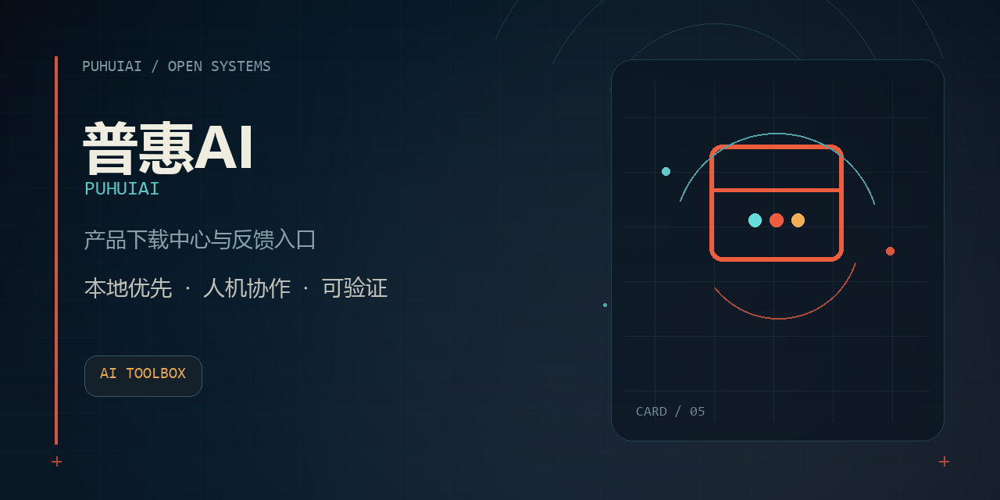

# 普惠AI 产品中心：AI Agent、提示词引擎与效率工具下载

普惠AI 产品中心集中展示和发布自研 AI 工具，包括 AI Agent 规范监视器、中文提示词拆解引擎、来电拦截助手和 Windows AI 工作台。所有产品提供 GitHub Releases 下载入口与 Issues 反馈渠道。

**在线访问：** https://puhuiai.github.io/website/

## 产品导航

| 产品 | 平台 | 用途 | 仓库 |
|:---|:---|:---|:---|
| 拦接宝 LanJieBao | Android | 来电拦截、AI 留言与号码归属地 | [lanjiebao](https://github.com/puhuiai/lanjiebao) |
| 猫盾 Maodun | Windows | AI Agent 规范监视与权限治理 | [maodun](https://github.com/puhuiai/maodun) |
| 普惠AI 指令拆解引擎 | Windows / CLI | 中文需求拆解与提示词生成 | [puhuiai-fanrenge](https://github.com/puhuiai/puhuiai-fanrenge) |
| 龙虾 Pro LobsterPro | Windows | AI Agent 桌面工作台 | [lobsterpro3](https://github.com/puhuiai/lobsterpro3) |

## 页面结构

[index.html](index.html) 是可直接由 GitHub Pages 发布的单文件下载中心。页面包含：

- 产品锚点：`#lanjiebao`、`#maodun`、`#fanrenge`、`#lobsterpro`
- 最新版下载按钮
- 每个产品的 GitHub 说明与反馈入口
- 搜索引擎与社交分享元数据
- 移动端响应式布局

## 发布

仓库通过 GitHub Pages 发布。更新 `index.html` 并推送到默认分支后，页面会自动刷新。

## 维护原则

- 下载链接只指向官方 GitHub Releases 或官方产品页
- 每个产品保持一致的名称、平台和用途描述
- 反馈统一进入对应仓库的 Issues
- 不收集与产品下载无关的个人信息

## 反馈

产品问题请前往对应仓库的 Issues。官网或下载入口问题请提交 [website Issues](https://github.com/puhuiai/website/issues)。

Built by 汪君 · 普惠AI
